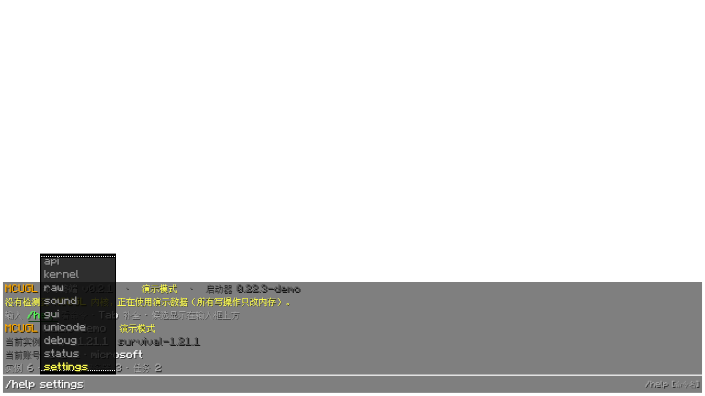

# MCUGL 命令终端（cmdFront）

一个「整活」性质的 MCUGL Launcher 前端包：把启动器当成 Minecraft 的命令方块终端。
所有操作都走 `/命令`，输入框上方是原版的候选列表，Tab 补全、↑↓ 翻历史、F3 调试面板、
成就 toast、死亡界面、纯白背景——一个都不少。


（字体直接来自 Minecraft 的 `assets`：`scripts/make-mc-font.mjs` 把原版位图字形转成 TrueType，
拉丁字母、数字、符号的宽度和字影都和游戏里一致；中文由 `unifont` 补字，`/unicode true` 可强制全 Unicode。）

## 它到底能干什么

- 启动器能做的事，这里都能用命令做：选实例、切账号、启游戏、直连服务器、
  装整合包 / 模组 / 光影、看任务、备份存档、改设置、管理第三方前端。
- `/api` 列出内核的 70 个方法（66 个 `mcugl.kernel/v1` 方法 + 4 个宿主方法），
  `/kernel <方法> '<JSON>'` 直接调用任意内核方法，返回的 JSON 会展开成彩色缩进树；`/raw on` 会把每次内核调用都按同样的结构附带出来。
- 补全不是查表：候选来自真实数据——实例列表、账号、收藏的服务器、模组、内核方法名，
  全都能 Tab 出来。
- 候选栏按原版来：只显示「当前正在补全的那个词」的命令名 / 参数，顶层命令不带前导 `/`，
  不重复已输入的文本、也不带解释文字（解释留给 `/help`）；选中那条整行变黄，其余灰色；
  宽度正好等于最宽的那条候选，一次显示 9 行，不画滚动条，鼠标滚轮一行一行翻。它是盖在
  聊天区之上的独立图层：候选出现不会挤动聊天区，和输入行之间留一道缝；上面 / 下面还有
  没露出来的候选时，对应一侧会压一条黑底 + 1px 黑白点阵的「黑白条」。
- 聊天区、输入行、候选栏三块半透明黑分别按原版取 0.5 / 0.5 / 0.82 的不透明度，背景是纯白；
  白字带黑色像素阴影，偏移量是「当前字体的一个视觉像素」：MC 位图字体 `fs/8`（16px 时 2px），
  中文那截由 `fillText()` 包成 `.cjk`、按 unifont 的细像素用 `fs/16`（16px 时 1px），随 GUI 缩放一起变；
  颜色按原版的「字色 × 25% 叠黑」用 `color-mix()` 算。输入框为空时的占位 `/help` 也用和预候选同样的
  不透明灰 `#aaaaaa`，所以「还没输入」和「输入 / 之后」不会突然变色。已经打出来的那截在输入框里
  用不透明灰 `#aaaaaa`「预告」显示（和聊天正文的 gray 同色；输入 `/se` 时后面跟着灰色的 `ttings`），候选列表本身
  不再重复它。
  滚动条是灰色直角矩形，滚一格正好走一行文字。聊天区的可视高度按整数行裁切，滚动位置
  永远停在行首——任何滚动方式都不会看到半行字；拖着滚动条走的时候内容不会一帧一跳，
  松手后才吸到最近的行首。
- `/unicode true|false` 切换字体优先级：默认 MC 位图字体在上（`mc_seven` 兜底、`unifont` 补缺字），
  `true` 时 `unifont` 在上、全部强制 Unicode 点阵；`false` 还原。
- 整活命令：`/say`、`/me`、`/tellraw`、`/title`、`/weather rain`、`/gamemode creative`、
  `/seed`、`/explode`。`/explode` 会真的震屏加死亡界面，死亡界面上点「重生」或按 Esc 继续。
- 内核返回的 JSON 会解析成缩进树——字段名青色、字符串绿色、数字金色、布尔紫色，
  长数组和超深结构自动折叠，不再糊一整屏大括号。

候选栏滚动时，还有内容的那一侧会压一道黑白条（黑底 + 2px 白 / 2px 黑的点阵），和原版一样：


## 先看效果

```bash
cd cmdFront
npm run serve          # 零依赖静态服务器，默认 http://127.0.0.1:5173
```

浏览器直接打开即可。**没有启动器内核时会自动切到演示模式**：内存里的假数据，
所有写操作只改内存、不碰文件，页面顶部会有一条黄色警告。

开发时可以用 URL 参数摆好画面，方便截图或演示：

```
?type=/se                 预填输入框并弹出候选
?type=/server%20          看子命令候选（左缘会对齐到当前词）
?type=/&scrollSuggest=52   先把候选栏滚两行，检查上下黑白边
?run=/help&run=/status    依次执行几条命令
```

## 装进启动器

```bash
npm run pack
# → dist-frontends/mcugl.cmdfront-0.2.1.mcuglf
```

然后在启动器里：**设置 → 开发者选项 → 前端（第三方 UI） → 导入前端包 → 选择这个
`.mcuglf` → 使用 → 重启（或点「重启前端」）**。

开发期也可以把 `MCUGL_FRONTEND` 指向 `cmdFront/frontend` 目录或 `.mcuglf` 文件，
省去每次打包。

## 键盘

| 按键 | 作用 |
| --- | --- |
| `Tab` / `Shift+Tab` | 补全并向前 / 向后轮换候选；命令名补全后自动补空格，并换成下一参数的候选 |
| `↑` / `↓` | 候选可见时轮换候选，否则翻命令历史 |
| `Enter` | 执行；不以 `/` 开头的输入当作聊天 |
| `Esc` | 依次关闭：暂停菜单 → 候选列表 → 死亡界面 → 清空输入 → 打开暂停菜单 |
| `F3` | 调试面板（模式、计数、时间天气、候选数、JSON 结构开关） |
| `F5` | 刷新页面（浏览器行为，前端没有拦截） |

鼠标也能用：候选行可以直接点，鼠标悬停在候选栏上用滚轮能翻看没露出来的行；聊天里的绿色文字（`直连`、`延迟`、`禁用`…）是可执行链接，点了就填进输入框。

## 命令速查

完整列表在页内敲 `/help`，单条用法 `/help <命令>`。分组：

| 分组 | 命令 |
| --- | --- |
| 界面 | `/help` `/clear` `/about` `/api` `/kernel` `/raw` `/sound` `/gui` `/unicode` `/debug` |
| 状态 | `/status` `/settings` `/set` `/sysinfo` `/java` `/log` `/key` `/open` `/resetwindow` `/pick` `/avatar` |
| 实例 | `/instances` `/select` `/mods` `/launchopts` `/clone` `/export` `/uninstall` |
| 账号 | `/accounts` `/account` `/login` `/loginstatus` `/loginprofile` `/logincancel` `/skin` |
| 启动 | `/launch` `/join` `/sessions` `/stop` `/server` |
| 内容 | `/search` `/versions` `/vanilla` `/install` `/loaders` `/loader` `/updates` `/pack` `/mod` `/bookmarks` `/bookmark` `/community` `/recommend` `/queue` |
| 任务 | `/tasks` `/task` `/backups` `/backup` `/restore` |
| 设置 | `/datasource` `/root` |
| 前端 | `/frontends` `/frontend` |
| 整活 | `/say` `/me` `/tellraw` `/title` `/weather` `/gamemode` `/seed` `/explode` |

举几个例子：

```mcfunction
/select create-1.20.1
/mods
/mod toggle sodium off
/server add 我的服 127.0.0.1:25565
/join 我的服
/search sodium mod
/queue <版本 id> install
/api launch
/kernel get_overview
```

## 结构

```
cmdFront/
├── frontend/                  ← 打包进去的就是这个目录
│   ├── index.html             外壳：白色背景、聊天区、候选列表、输入行、叠层
│   ├── styles.css             Minecraft 像素风样式（字体槽在 fonts/）
│   ├── app.js                 组装 ctx、键盘、历史、补全会话、启动流程
│   ├── commands.js            命令注册表 + 分词 + 补全引擎 + 执行器
│   ├── ui.js                  渲染层：聊天、候选列表、输入框预候选、音效、叠层、成就
│   ├── jsonview.js            JSON → 彩色缩进树（/kernel 与 /raw 用）
│   ├── methods.js             内核 70 个方法的目录（说明、参数、分组、示例）
│   ├── kernel.js              内核桥接：有 __TAURI_INTERNALS__ 就真调用，否则演示
│   ├── demo.js                内存演示后端（写操作只改内存）
│   ├── frontend.json          包清单
│   └── fonts/
│       ├── mc_vanilla.ttf     从 MC assets 生成的位图字体（首选）
│       ├── mc_seven.woff2     备用像素字
│       ├── unifont.woff2      中文补字 / `/unicode` 首选
│       └── README.md          字体的来历、生成方式、授权说明
├── scripts/
│   ├── pack.mjs               打包成 .mcuglf（来自 mcugl-buildtool）
│   ├── make-mc-font.mjs       MC 位图 assets → mc_vanilla.ttf
│   ├── mc-font/               assets 副本（ascii/accented/nonlatin + provider json）
│   ├── kernel-methods.json    功能对等清单（66 个方法）
│   ├── serve.mjs              本地预览服务器
│   └── selftest.mjs           命令行层自测（纯 Node）
└── docs/preview.png
```

分层很清楚：`commands.js` 完全不碰 DOM，所有输入来自 `ctx`，所以能在 Node 里直接测；
`ui.js` 只管画和响；`app.js` 把两者缝起来。

## 自测

```bash
npm test
```

43 项，纯 Node、零依赖，覆盖：

- 70 个方法的目录完整性（说明、分组、参数提示）
- `snake_case → camelCase` 参数转换（内核要 camelCase）
- 分词：引号、转义、多余空白
- 补全：命令名、子命令字母序、实例 / 账号 / 服务器 / 模组 / 内核方法名
- 补全结果能直接执行
- 未知命令、缺参数、非法取值都抛 `UsageError` 且带用法
- `/status`、`/help`、`/select`、`/server add`、`/launch`、`/join`、`/mod toggle`、
  `/raw`（JSON 树）、`/kernel`（JSON 树）、`/api`、`/sound`、`/weather`、`/gamemode`、`/explode`、`/say`、聊天
- 每条命令都有说明、分组、路由，且没有重名
- JSON 树：对象/数组换行、短数组单行、长数组折叠、超长字符串截断
- `/` 的候选无重复、一条不缺（候选栏只显示 9 行，其余靠滚轮 + Tab 翻）

## 实现上的几个选择

- **参数一律 camelCase**。内核命令在 Rust 侧是 snake_case，但官方前端调 `invoke` 时
  传的是 camelCase（Tauri 会转换），所以命令层直接用 `instanceId`、`expectedRevision`。
  `/kernel` 手写 JSON 时会自动把 snake_case 转过去，省得记两套。
- **功能对等门**。`mcugl-buildtool` 的打包脚本会扫文本，要求 `kernel-methods.json`
  里的 66 个方法名全部出现在前端代码里，否则拒绝出包。这里的 66 个方法都真实接进了
  命令（不是占位符），`npm run pack` 的 `覆盖：66/66` 就是它的输出。
- **演示后端不是 mock 字符串**。`demo.js` 维护一份可变内存数据，`select_instance` 真的
  改选中实例、`save_server` 真的追加收藏、`toggle_mod` 真的翻转开关，连 revision 都自增。
  所以补全和真实模式下的行为一致，浏览器里也能完整体验。
- **背景是纯白**。原来那套 canvas 方景（太阳、云、阶梯山丘）代码还在，但
  `#panorama / #sky-tint / #weather / #flash` 现在都 `display:none`，只留白底；三块面板直接
  压在白色上，`#log`、`#bar`、`#suggest` 的 0.5 / 0.5 / 0.82 才和原版截图里量出来的一致。
- **候选栏的对齐是量出来的**。`measureSuggestOffset()` 用 canvas 按输入框同一套字体量出
  已输入前缀的像素宽度，整块候选面板右移，所以行里只需要画候选本身，不会重复命令。
- **候选栏宽度也是量出来的**。`fitSuggestWidth()` 把所有候选逐条量一遍，取最宽的那条
  （再夹到可用宽度内），所以 `/server ` 下面只有四个短词时面板很窄，`/` 时按最长的命令走。
- **候选栏是浮层，不占聊天区的位置**。`#suggest` 是 `position:absolute` + `z-index:2`，
  `#log` 是 `z-index:1`、`#bar` 是 `z-index:3`；`positionSuggest()` 按 `#bar` 的顶边反算
  `bottom`，所以候选出现/消失都不会改变聊天区的布局，底边和输入行之间始终留 2px 左右的缝。
- **黑白条是滚动余量的提示**。`updateSuggestEdges()` 比较 `scrollTop` 与
  `scrollHeight/clientHeight`，上面还有内容就加 `data-more-up`、下面还有就加
  `data-more-down`，CSS 在对应内侧画一条 6px 黑底 + 2px 白 / 2px 黑点阵的条。
- **滚轮按行步进，而且只有整行**。`#log` 和 `#suggest` 的 `wheel` 事件都被接管，一格滚轮
  固定走一行文字高度；`fitLog()` 把聊天区高度裁成 `行高 × 整数行`，`snapLog()` /
  `snapSuggest()` 再把 `scrollTop` 吸回行首——触控板、键盘翻页都不会留下半行。
  `fitSuggestHeight()` 同理，候选栏高度永远是 9 行整（或更少）加边框。
- **拖动滚动条时不做逐帧纠正**。以前 `scroll` 事件里直接吸附 `scrollTop`，手指每移动一点就
  被改回去，看起来就是「乱跳」。现在按下鼠标期间完全不写 `scrollTop`（`_logPointer`），
  松开指针才 `snapLog()`；触控板/键盘则等滚动停下（`scrollend` 或 160ms 静默）再吸附。
  所以拖动过程是平滑的，最终仍停在整行。
- **预候选画在输入框里**。`renderSuggest()` 只给候选行一个整行单色（选中黄、其余灰），
  已输入的那截交给 `updateGhost()` / `positionGhost()`：把选中候选去掉已输入部分后的
  剩字写进 `#cmd-ghost`（不透明 `#aaaaaa`，直接取聊天正文的 gray），用 canvas 按输入框
  字体量出光标位置贴上去，所以 `/se` 后面会跟着灰色的 `ttings`，而列表里的 `settings`
  仍是完整的一条候选。Tab 补完一个词以后 `typed` 会跟着更新成整条候选，预候选随即消失，
  不会再把刚补上的词重复画一遍。
- **字体就是 Minecraft 的位图字体**。`scripts/make-mc-font.mjs` 读 `scripts/mc-font/`
  里从游戏 assets 复制的 `ascii` / `accented` / `nonlatin_european` 位图，把每个字形
  转成矩形轮廓，按原版的 `advance = 最右像素 + 1` 写进 `mc_vanilla.ttf`（`unitsPerEm = 128`，
  16px 字号正好是 2 倍 GUI）。CSS 里 `MCUGL Vanilla` 排第一，`mc_seven` 兜底、`unifont`
  补中文；`/unicode true` 把 `unifont` 提到最前。字影颜色用
  `color-mix(in srgb, currentColor 25%, #000)`，就是原版「字色 25% 叠黑」的规则。

## 已知限制

- 演示模式覆盖 66 个方法，但 `reset_window`、`open_folder`、`pick_file`、`pick_folder`、
  `set_offline_skin`、`remove_game_root`、`save_custom_sources` 在真实内核里也依赖桌面
  环境，演示模式会返回 `UNSUPPORTED`——这是故意的，免得让你以为操作成功了。
- 内核模式下 `pick_file` / `pick_folder` 会弹系统对话框，需要 Tauri 窗口在前台。
- 命令历史只存在内存里，刷新就没了（不写 localStorage，避免和启动器的存储策略打架）。
- 聊天不接真实多人服务器，`/say` 只显示在自己的终端里。
